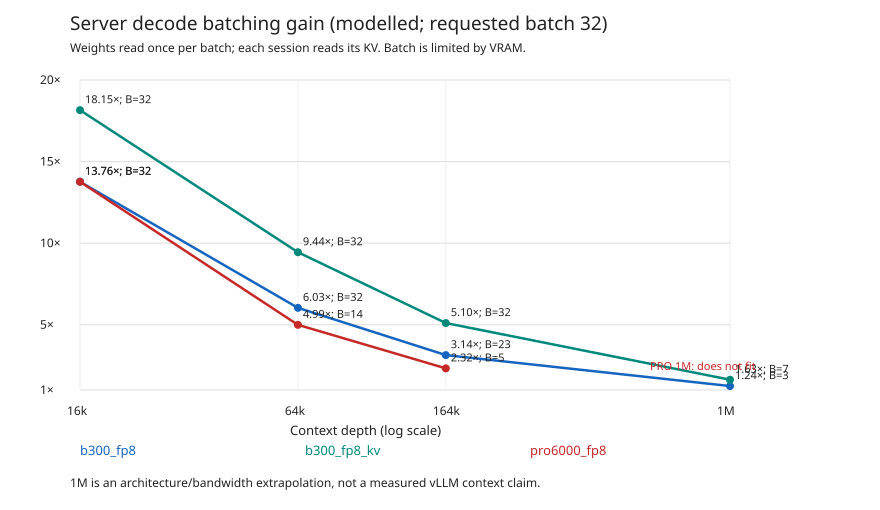

# Engine run20: vLLM economics, decode batching, small teams and admitted APIs

Branch `engine-r20`, based on signed run19 producer
`3a1eed0dbb7962bca082e5941e0853122ae70a5e`. Its independent review was pending
at branching. The later R19 review requests one rental coverage-label fix,
with no numeric error. No accepted R19 replacement exists; its exports remain
frozen under this task. R20 cost rows carry explicit workload_scope, including
10885/39904,27.28%, row-specific monthly normalization and full-workload
unsupported status; a named regression and rental_missing_scope fault cover
that class. No R19 acceptance is claimed. R10c acceptance of f7aeef95 was
subsequently observed. This delivery is ready for independent review, not
accepted paper prose. No paper TeX or historical output was rewritten.

R14 current publication is on the engine-r21 continuation; the branch/head above identifies the original R20 numeric producer. Archival5090 server data are not used in the paper.

## Scope and principal findings

All alternatives use the same10885 of39904 fitted calls (27.277967%).
End depth is at most249000; new-token delta512..10000. This intersection is
reweighted to the requested daily loads, rather than pretending to price the
unconditioned workload. The full-workload price is an explicit alarm.

Costs below are USD per person-month for the **open-model component**. Other
commercial-model calls are an equal omitted addend. Those calls are not free;
adding them changes the displayed multiples but leaves like-for-like cost
crossings unchanged. Light/medium/heavy mean200/800/2500 total calls/day,
21workdays,8active hours,70% target server utilization. Open-model shares
are20/50/100%. Client power/front cost is charged when a hybrid is purchased
as a dedicated scenario, including at low load.

vLLM FP8 is the main PRO6000/B300 server configuration; llama.cpp Q4 remains
an explicitly labelled sensitivity. This is an engine **and format** change,
not a controlled identical-weight-precision speed comparison. FP8 KV on PRO
failed startup and is refused. B300 FP8 KV has measured prefill, but its bridge
reuse remains an assumption. Server decode is modelled, not newly measured.

## API admission and cache accounting

The offline2026-10-29 `qwen/qwen3.8-27b` endpoint snapshot is the only ranking
source. Admission requires context262144 for the main section,1000000 for
the million section, declared implicit caching or an explicit cache-write
tariff, a cache-read tariff, and every recorded5m/30m/1d availability window
at least95%. Missing availability remains disclosed and unverified. Prices
are the snapshot prices; its descriptive discount field is not applied twice.
Median means the middle admitted **actual endpoint**, ordered by effective
same-mix call cost; for an even count the upper middle is used.

The98.1% cache-token share is sourced, not missing: NOTES, heading
“Статистика сессий Ивана и перекалибровка (2026-10-30)”, attributes the data
to the owner's session-stat archive `ivmbp-session-stats-20261030.tgz`,
sha256 prefix9f8dad04. It reports245.9/250.7billion input tokens from cache,
rounded98.1%. The exact source excerpt, source line numbers and observed
source hash are committed in
`data/measurements/run20-2026-11-03/owner-cache-notes-excerpt.txt`.
This is a commercial-agent aggregate applied as a scenario, **not verified
cache behaviour at OpenRouter or any particular endpoint**.

Expected billing is `input*(h*cache_read+(1-h)*cache_write)+output*output_price`;
missing cache-write tariff uses prompt price. The1.9% allowance is billed,
including explicit cache-write premiums. Original normalization-group previous
outputs are added to input before selecting common indices, so filtering
cannot reset the cache boundary. The1M tariff illustration reserves mean
output space inside a total1M-token context. It is not a1M hybrid cost claim.

Admitted baseline endpoints and effective USD/1000conditional calls:

| Profile | Endpoint | Role | USD/1000 | Cache fraction |
|---|---|---|---|---|
| main | chutes/fp8 | cheapest | 1.213 | 0.981 |
| main | deepinfra/bf16 | median | 5.917 | 0.981 |
| million | phala | cheapest | 54.107 | 0.981 |
| million | novita | median | 92.859 | 0.981 |

There are17 main admitted endpoints and2 million-context admitted endpoints.
Chutes remains because it passes the stated criteria. No runtime cache test
has been invented. `api_admission.csv` contains every admitted/excluded row
and its reasons; the exclusions are:

| Profile | Endpoint | Exclusion |
|---|---|---|
| main | mancer/fp8 | caching_not_declared; cache_read_price_missing |
| main | alibaba | recorded_availability_below_95_or_invalid |
| main | venice/fp8 | caching_not_declared; cache_read_price_missing |
| main | cerebras/fp16 | context_below_262144 |
| million | darkbloom/fp4 | context_below_1000000 |
| million | chutes/fp8 | context_below_1000000 |
| million | near-ai/fp8 | context_below_1000000 |
| million | ionstream/fp8 | context_below_1000000 |
| million | reka/fp8 | context_below_1000000 |
| million | modal | context_below_1000000 |
| million | dekallm | context_below_1000000 |
| million | wafer/fp8 | context_below_1000000 |
| million | tenstorrent/fp4 | context_below_1000000 |
| million | deepinfra/bf16 | context_below_1000000 |
| million | mancer/fp8 | context_below_1000000; caching_not_declared; cache_read_price_missing |
| million | modelrun/fp4 | context_below_1000000 |
| million | akashml/fp8 | context_below_1000000 |
| million | parasail/fp8 | context_below_1000000 |
| million | coreweave/fp8 | context_below_1000000 |
| million | alibaba | recorded_availability_below_95_or_invalid |
| million | cloudflare | context_below_1000000 |
| million | venice/fp8 | context_below_1000000; caching_not_declared; cache_read_price_missing |
| million | cerebras/fp16 | context_below_1000000 |

The data-only provider interface is `provider_cache_hits.measurements` in
`calc/hybridcalc/data/run20-economics.json`: endpoint tag, main/million profile,
same model, timestamp/source, integer input and cached-token counts. Invalid,
duplicate, wrong-model or unproven records refuse. A valid observation changes
effective costs and rankings directly. The interface is currently empty.

## Measured server paths and bridge limits

B300 archive1325ae41…11bc and PRO phase-A archivefd0bc08c…6040 are verified
through the existing kit manifest loaders. FACTS1c gives B300 marginal cold
prefill24031/14667/8673tok/s at16k/100k/249k, and24841/18555/12806 with FP8 KV;
finite-delta cold23151tok/s at delta10000/16k is about14x llama.cpp1663.
PRO cold endpoints are8122 and2209tok/s. Economic cached requests use actual
cached elapsed TTFT, separately retaining useful and processed-token geometry.
The B300 default2k/16k request costs0.171858s, not2704processed tokens credited
as2000useful tokens. Interpolation is in elapsed time across the measured
2k/10k delta and16k/65k/131k/249k depth coordinates. Below2k and below16k,
the extension/shallow hold is explicitly estimated; above10k or249k refuses.

PR16 bridge evidence is available locally: B300 accepted smoke archive
`3f48838ae8e3f5e8dc7a860e2a383b9f31b1bd4b2c27addba15e8f98ea01d1ff`;
PRO landed9348ecd6 smoke archive
`839911233bc550f5ea8a1d998d09377dcd8c13f030b4f4b04dc3d628d4f2a9c4`.
Full archive digests were checked and selected raw JSONL preserved, without
copying model files or downloading anything. Staged chunks require successful
terminal import and exact applied token counts. The measured server envelope
is0.431181ms/converted token on B300 and0.623618ms on PRO, over31630converted
tokens each. It includes gather/conversion and server work, not just kernels.

Main hybrid timing is `max(cached vLLM TTFT, delta*smoke_server_seconds/token)`.
The coefficient is a token-weighted smoke average projected through the
origin. It is not a measured short-turn fit or an upper confidence bound:
the54-token smoke increment has substantial fixed overhead. This retains
the pooled measured work without adding the same prefill twice. Its
portability to long cached deltas, concurrent service, Mac clients and FP8 KV
is an assumption. `bridge=none` is a zero-extra-bridge lower bound, separately
exported. Smoke total TTFT or CUDA import is never added to Mac import.
Mac import remains the R16 depth-conditioned prototype estimate, including
the M5 portability qualification. The smoke's checker exit5 is heterogeneous
and uncalibrated: PRO top1 61/64 at8k,60/64 at32k, KL0.0202/0.0233; B30032k
KL0.0233. These are finite functional/quality observations, not production
quality acceptance. The measured bridge can absorb much of the kernel-only
prefill gain.

## Decode batching and capacity

For batchB, weightsW, per-session depthd KV bytesK and recurrent trafficS:
`aggregate = B*effective_bandwidth/(W+B*(K*d+S))`.
Weights are read once per batch; each stream reads its own KV/state every
token. Batch is clamped to floor((VRAM-W-workspace)/(K*d+resident_state)).
FP8 weights27GB and workspace8GB are estimates; B300288GB/8TB/s and
PRO96GB/1.79TB/s are inherited hardware assumptions,70% bandwidth efficiency.
Default vLLM KV is BF16,65536B/token; FP8 KV32768B/token. The q8_0 wire remains
34816B/token and156893184B state. One state traffic pass/token is modelled.
Capacity budgets one recurrent state/session; additional vLLM prefix-checkpoint
and allocator overhead is unmeasured. These are conditional model capacities,
not production residency guarantees.
Q4 llama sensitivities use18.97GB weights and34816B/token KV.

Requested batch32, with actual admitted batch and modelled gain:

| Server | Depth | Admitted batch | Gain |
|---|---|---|---|
| b300_fp8 | 16000.000 | 32.000 | 13.764 |
| b300_fp8 | 64000.000 | 32.000 | 6.035 |
| b300_fp8 | 164000.000 | 23.000 | 3.138 |
| b300_fp8 | 1000000.000 | 3.000 | 1.241 |
| b300_fp8_kv | 16000.000 | 32.000 | 18.152 |
| b300_fp8_kv | 64000.000 | 32.000 | 9.444 |
| b300_fp8_kv | 164000.000 | 32.000 | 5.103 |
| b300_fp8_kv | 1000000.000 | 7.000 | 1.629 |
| pro6000_fp8 | 16000.000 | 32.000 | 13.764 |
| pro6000_fp8 | 64000.000 | 14.000 | 4.992 |
| pro6000_fp8 | 164000.000 | 5.000 | 2.325 |
| pro6000_fp8 | 1000000.000 | refused/unpriced | refused/unpriced |

The standalone SVG is generated from `decode_scaling.csv`; a separate hash
binding and INDEX cover source and figure.1M is an architecture/bandwidth
extrapolation, not an admitted native vLLM session. A1M default-KV PRO session
does not fit and is an alarm, never a zero throughput or missing row.

The planned1/8/32stream measurements at16k/64k/164k have a data-only interface:
`server_decode.measurements`, with server, count, depth, aggregate rate,
engine=vllm, date and source. Sparse curves require a spanning single-stream
reference. Exact admitted count/depth curves interpolate only within their
observed range; other coordinates stay explicitly modelled. Memory-invalid
observations refuse:32streams at164k cannot fit B300/default or PRO/default;
B300 FP8 KV can support that planned shape.

Economics consumes these decode curves. It also conserves the existing
four-streams/person assumption over the **entire fleet**: balanced integer
per-GPU batches cannot each claim4T streams. The count comes from
`paper_tables.streams`, independent of `hosting.sessions_per_person`.
Decode and tool-pause occupancy bound all-server service; insufficient offered
concurrency is an explicit capacity alarm even after every stream has a GPU.
Buying more idle boxes cannot make an infeasible request load cheap.

## Residency, cost basis and small teams

Four retained sessions/person reserve their full249k end-depth KV plus state.
A node has900GB usable NVMe by assumption. Each GPU holds its own weights,
workspace and complete active sessions; spare VRAM fragments are not pooled.
PRO vLLM misses rebuild the full cold prefix using the measured cold fit;
no qualified vLLM restore is present. A rebuild already contains pending local
history, so only resident opportunities pay deferred journal catch-up.
5090 uses the R19 native save+restore measurements. Uniform session popularity
and reservation/cache budgets remain estimates.

Own-cluster fleets use the smallest sufficient integer under the monotone
aggregate bandwidth/residency model; hybrid fleets retain R19's sufficient
provision policy and are not a proof of the minimal hybrid fleet. API/own
cluster/hybrid all price the identical call indices. Client throughput overflow
is decoded on the server and charged; physically unserviceable demand gets
an alarm rather than a fabricated monthly cost.

Bought PRO uses inherited30000USD whole-box capex; bought5090 uses the R19
sold-out1999.99USD list price plus1500USD estimated host allowance. These are
not current available whole-box quotes. B300 is the inherited eight-GPU node.
Client64GB/128GB full new prices5099/6699USD are inherited estimates, not new
quotes;4year/35%residual client amortization gives69.049/90.716USD/month.
Already-owned client capex is zero; power and front remain charged. The128GB
client reuses the measured64GB SoC curves as a portability estimate.

Rental is a dedicated730h calendar lease, including idle time, with storage
separate. PRO/B300 hourly prices are inherited estimates;5090 uses the observed
Vast upper offer0.522USD/h, not a market-rate claim. Bought nodes use office
125MB/s/1ms; rental uses the existing engine WAN112.5MB/s/400ms. No persistence
across terminated rentals or unmeasured cold-start qualification is claimed.

`small_team_cost.csv` contains all576 requested combinations:3/5/10/20people,
3loads,20/50/100% open share,64/128GB,owned/new clients,PRO/5090,bought/rented.
The table below selects100% open share,owned64GB,bought PRO6000 on vLLM; all alternatives
include explicit server decode overflow and the same conditional workload:

| Load | People | PRO boxes | Hybrid/month | Best vLLM cluster/month | Median API/month | Cheapest API/month |
| --- | --- | --- | --- | --- | --- | --- |
| light | 3 | 1 | 212.206 | 204.686 | 24.853 | 5.095 |
| light | 5 | 1 | 130.332 | 245.623 | 24.853 | 5.095 |
| light | 10 | 1 | 68.926 | 184.217 | 24.853 | 5.095 |
| light | 20 | 2 | 68.926 | 184.217 | 24.853 | 5.095 |
| medium | 3 | 1 | 212.206 | 614.058 | 99.413 | 20.378 |
| medium | 5 | 2 | 253.143 | 491.246 | 99.413 | 20.378 |
| medium | 10 | 3 | 191.737 | 491.246 | 99.413 | 20.378 |
| medium | 20 | 6 | 191.737 | 460.543 | 99.413 | 20.378 |
| heavy | 3 | 7 | 1440.321 | 818.743 | 310.665 | 63.681 |
| heavy | 5 | 13 | 1604.070 | 859.681 | 310.665 | 63.681 |
| heavy | 10 | 26 | 1604.070 | 798.275 | 310.665 | 63.681 |
| heavy | 20 | 52 | 1604.070 | 767.572 | 310.665 | 63.681 |

`team_break_even.csv` scans every integer1..500. A “fromN” result requires
strict improvement for every subsequent scanned size; the first lucky box
rounding crossing is insufficient. It is not a theorem beyond500. Selected
words-ready comparisons for100% open,owned64GB,bought nodes:

| Load | Hybrid node | Compared with | Words-ready bound |
|---|---|---|---|
| light | pro6000_fp8 | api_cheapest | common_measured_r20: pro6000_fp8 hybrid versus the cheapest admitted API: no sustained crossing through 500 people; server=RTX PRO 6000 vLLM FP8 (pro6000_fp8); billing=bought; link=office office_gigabit, 125 MB/s, RTT 1 ms (assumed goodput and RTT); client=M5 Max 64 GB (m5max64) owned; s=1.0; cache allowance=98.1% owner commercial token-cache allowance; provider behaviour unverified; 1.9% misses billed; load=light; coverage=conditional common measured subset 10885/39904 (27.28%); normalized to 4200 calls/person-month; full workload unsupported; dedicated fleet; hybrid fleet sufficient, not minimal; deep rates extrapolated where beyond measured ladder. R20 common measured prefill envelope; 128GB M5 rate portability estimated; decode batching modelled; admitted snapshot median; upper middle for even endpoint counts; tariff discount treated as already reflected, unverified interpretation. |
| light | pro6000_fp8 | api_median | common_measured_r20: pro6000_fp8 hybrid versus the admitted median API: no sustained crossing through 500 people; server=RTX PRO 6000 vLLM FP8 (pro6000_fp8); billing=bought; link=office office_gigabit, 125 MB/s, RTT 1 ms (assumed goodput and RTT); client=M5 Max 64 GB (m5max64) owned; s=1.0; cache allowance=98.1% owner commercial token-cache allowance; provider behaviour unverified; 1.9% misses billed; load=light; coverage=conditional common measured subset 10885/39904 (27.28%); normalized to 4200 calls/person-month; full workload unsupported; dedicated fleet; hybrid fleet sufficient, not minimal; deep rates extrapolated where beyond measured ladder. R20 common measured prefill envelope; 128GB M5 rate portability estimated; decode batching modelled; admitted snapshot median; upper middle for even endpoint counts; tariff discount treated as already reflected, unverified interpretation. |
| light | pro6000_fp8 | own_cluster | common_measured_r20: pro6000_fp8 hybrid versus the cheapest capacity-admitted PRO6000/B300 vLLM own cluster: cheaper from 4 people through 500 scanned; server=RTX PRO 6000 vLLM FP8 (pro6000_fp8); billing=bought; link=office office_gigabit, 125 MB/s, RTT 1 ms (assumed goodput and RTT); client=M5 Max 64 GB (m5max64) owned; s=1.0; cache allowance=98.1% owner commercial token-cache allowance; provider behaviour unverified; 1.9% misses billed; load=light; coverage=conditional common measured subset 10885/39904 (27.28%); normalized to 4200 calls/person-month; full workload unsupported; dedicated fleet; hybrid fleet sufficient, not minimal; deep rates extrapolated where beyond measured ladder. R20 common measured prefill envelope; 128GB M5 rate portability estimated; decode batching modelled; admitted snapshot median; upper middle for even endpoint counts; tariff discount treated as already reflected, unverified interpretation. |
| medium | pro6000_fp8 | api_cheapest | common_measured_r20: pro6000_fp8 hybrid versus the cheapest admitted API: no sustained crossing through 500 people; server=RTX PRO 6000 vLLM FP8 (pro6000_fp8); billing=bought; link=office office_gigabit, 125 MB/s, RTT 1 ms (assumed goodput and RTT); client=M5 Max 64 GB (m5max64) owned; s=1.0; cache allowance=98.1% owner commercial token-cache allowance; provider behaviour unverified; 1.9% misses billed; load=medium; coverage=conditional common measured subset 10885/39904 (27.28%); normalized to 16800 calls/person-month; full workload unsupported; dedicated fleet; hybrid fleet sufficient, not minimal; deep rates extrapolated where beyond measured ladder. R20 common measured prefill envelope; 128GB M5 rate portability estimated; decode batching modelled; admitted snapshot median; upper middle for even endpoint counts; tariff discount treated as already reflected, unverified interpretation. |
| medium | pro6000_fp8 | api_median | common_measured_r20: pro6000_fp8 hybrid versus the admitted median API: no sustained crossing through 500 people; server=RTX PRO 6000 vLLM FP8 (pro6000_fp8); billing=bought; link=office office_gigabit, 125 MB/s, RTT 1 ms (assumed goodput and RTT); client=M5 Max 64 GB (m5max64) owned; s=1.0; cache allowance=98.1% owner commercial token-cache allowance; provider behaviour unverified; 1.9% misses billed; load=medium; coverage=conditional common measured subset 10885/39904 (27.28%); normalized to 16800 calls/person-month; full workload unsupported; dedicated fleet; hybrid fleet sufficient, not minimal; deep rates extrapolated where beyond measured ladder. R20 common measured prefill envelope; 128GB M5 rate portability estimated; decode batching modelled; admitted snapshot median; upper middle for even endpoint counts; tariff discount treated as already reflected, unverified interpretation. |
| medium | pro6000_fp8 | own_cluster | common_measured_r20: pro6000_fp8 hybrid versus the cheapest capacity-admitted PRO6000/B300 vLLM own cluster: cheaper from 2 people through 500 scanned; server=RTX PRO 6000 vLLM FP8 (pro6000_fp8); billing=bought; link=office office_gigabit, 125 MB/s, RTT 1 ms (assumed goodput and RTT); client=M5 Max 64 GB (m5max64) owned; s=1.0; cache allowance=98.1% owner commercial token-cache allowance; provider behaviour unverified; 1.9% misses billed; load=medium; coverage=conditional common measured subset 10885/39904 (27.28%); normalized to 16800 calls/person-month; full workload unsupported; dedicated fleet; hybrid fleet sufficient, not minimal; deep rates extrapolated where beyond measured ladder. R20 common measured prefill envelope; 128GB M5 rate portability estimated; decode batching modelled; admitted snapshot median; upper middle for even endpoint counts; tariff discount treated as already reflected, unverified interpretation. |
| heavy | pro6000_fp8 | api_cheapest | common_measured_r20: pro6000_fp8 hybrid versus the cheapest admitted API: no sustained crossing through 500 people; server=RTX PRO 6000 vLLM FP8 (pro6000_fp8); billing=bought; link=office office_gigabit, 125 MB/s, RTT 1 ms (assumed goodput and RTT); client=M5 Max 64 GB (m5max64) owned; s=1.0; cache allowance=98.1% owner commercial token-cache allowance; provider behaviour unverified; 1.9% misses billed; load=heavy; coverage=conditional common measured subset 10885/39904 (27.28%); normalized to 52500 calls/person-month; full workload unsupported; dedicated fleet; hybrid fleet sufficient, not minimal; deep rates extrapolated where beyond measured ladder. R20 common measured prefill envelope; 128GB M5 rate portability estimated; decode batching modelled; admitted snapshot median; upper middle for even endpoint counts; tariff discount treated as already reflected, unverified interpretation. |
| heavy | pro6000_fp8 | api_median | common_measured_r20: pro6000_fp8 hybrid versus the admitted median API: no sustained crossing through 500 people; server=RTX PRO 6000 vLLM FP8 (pro6000_fp8); billing=bought; link=office office_gigabit, 125 MB/s, RTT 1 ms (assumed goodput and RTT); client=M5 Max 64 GB (m5max64) owned; s=1.0; cache allowance=98.1% owner commercial token-cache allowance; provider behaviour unverified; 1.9% misses billed; load=heavy; coverage=conditional common measured subset 10885/39904 (27.28%); normalized to 52500 calls/person-month; full workload unsupported; dedicated fleet; hybrid fleet sufficient, not minimal; deep rates extrapolated where beyond measured ladder. R20 common measured prefill envelope; 128GB M5 rate portability estimated; decode batching modelled; admitted snapshot median; upper middle for even endpoint counts; tariff discount treated as already reflected, unverified interpretation. |
| heavy | pro6000_fp8 | own_cluster | common_measured_r20: pro6000_fp8 hybrid versus the cheapest capacity-admitted PRO6000/B300 vLLM own cluster: no sustained crossing through 500 people; server=RTX PRO 6000 vLLM FP8 (pro6000_fp8); billing=bought; link=office office_gigabit, 125 MB/s, RTT 1 ms (assumed goodput and RTT); client=M5 Max 64 GB (m5max64) owned; s=1.0; cache allowance=98.1% owner commercial token-cache allowance; provider behaviour unverified; 1.9% misses billed; load=heavy; coverage=conditional common measured subset 10885/39904 (27.28%); normalized to 52500 calls/person-month; full workload unsupported; dedicated fleet; hybrid fleet sufficient, not minimal; deep rates extrapolated where beyond measured ladder. R20 common measured prefill envelope; 128GB M5 rate portability estimated; decode batching modelled; admitted snapshot median; upper middle for even endpoint counts; tariff discount treated as already reflected, unverified interpretation. |

## Server-engine sensitivity and rechecked multiples

At50people,heavy workload and20% open share, the dedicated bought fleets
and a separate resident shared-work-price allocation are:

| Server | Bridge | Dedicated hybrid/month | Dedicated cluster/month | Shared prefill/month | Shared hybrid/month | Median/shared hybrid | Cheapest/shared hybrid |
|---|---|---|---|---|---|---|---|
| b300_fp8 | none | 681.552 | 674.032 | 16.528 | 41.958 | 1.481 | 0.304 |
| b300_fp8 | measured_envelope | 681.552 | 674.032 | 46.441 | 71.753 | 0.866 | 0.178 |
| b300_fp8_kv | none | 344.536 | 337.016 | 16.140 | 38.287 | 1.623 | 0.333 |
| b300_fp8_kv | measured_envelope | 344.536 | 337.016 | 46.697 | 68.742 | 0.904 | 0.185 |
| pro6000_fp8 | none | 118.050 | 331.591 | 12.043 | 36.952 | 1.681 | 0.345 |
| pro6000_fp8 | measured_envelope | 118.050 | 331.591 | 17.680 | 42.510 | 1.462 | 0.300 |
| llama_b300 | none | 344.536 | 337.016 | 99.705 | 121.176 | 0.513 | 0.105 |
| llama_b300 | measured_envelope | 344.536 | 337.016 | 99.705 | 121.176 | 0.513 | 0.105 |
| llama_pro6000 | none | 56.645 | 98.249 | 16.775 | 38.674 | 1.607 | 0.329 |
| llama_pro6000 | measured_envelope | 56.645 | 98.249 | 16.775 | 38.674 | 1.607 | 0.329 |

At heavy load and20% open share, a new64GB client costs69.049USD/month
in device amortization alone, exceeding the admitted median API component
62.133USD/month. Under the full-new-purchase basis, neither server sharing
nor larger team size removes that device cost. See the explicit new-client
rows rather than applying owned-client multiples to new purchases.

The shared allocation prices GPU work at the inherited hourly price per GPU,
70% utilization, retains all sessions with separately priced NVMe, charges
egress, client energy/front and full-server decode overflow. It assumes a
resident shared service and sufficient offered batching; it does not promise
a small team a fractional dedicated box, retain a session for free or establish
throughput under an independently measured service queue. Kernel-only savings
must be read alongside bridge, KV format, residency and client overflow.
Multiples are ratios for the open-model component and this stated cost basis.

The three historical claims below are the PRO selection; quote `paper/paper_claims.csv`. The root `paper_claims.csv` remains an explicitly archival mixed-server statement:

| Load | Previous claim | Run20 conditional result |
|---|---|---|
| heavy | cheaper at every team size | common_measured_r20: pro6000_fp8 hybrid versus the cheapest capacity-admitted PRO6000/B300 vLLM own cluster: no sustained crossing through 500 people; server=RTX PRO 6000 vLLM FP8 (pro6000_fp8); billing=bought; link=office office_gigabit, 125 MB/s, RTT 1 ms (assumed goodput and RTT); client=M5 Max 64 GB (m5max64) owned; s=1.0; cache allowance=98.1% owner commercial token-cache allowance; provider behaviour unverified; 1.9% misses billed; load=heavy; coverage=conditional common measured subset 10885/39904 (27.28%); normalized to 52500 calls/person-month; full workload unsupported; dedicated fleet; hybrid fleet sufficient, not minimal; deep rates extrapolated where beyond measured ladder. R20 common measured prefill envelope; 128GB M5 rate portability estimated; decode batching modelled; admitted snapshot median; upper middle for even endpoint counts; tariff discount treated as already reflected, unverified interpretation. |
| light | cheaper from50 | common_measured_r20: pro6000_fp8 hybrid versus the cheapest capacity-admitted PRO6000/B300 vLLM own cluster: cheaper from 4 people through 500 scanned; server=RTX PRO 6000 vLLM FP8 (pro6000_fp8); billing=bought; link=office office_gigabit, 125 MB/s, RTT 1 ms (assumed goodput and RTT); client=M5 Max 64 GB (m5max64) owned; s=1.0; cache allowance=98.1% owner commercial token-cache allowance; provider behaviour unverified; 1.9% misses billed; load=light; coverage=conditional common measured subset 10885/39904 (27.28%); normalized to 4200 calls/person-month; full workload unsupported; dedicated fleet; hybrid fleet sufficient, not minimal; deep rates extrapolated where beyond measured ladder. R20 common measured prefill envelope; 128GB M5 rate portability estimated; decode batching modelled; admitted snapshot median; upper middle for even endpoint counts; tariff discount treated as already reflected, unverified interpretation. |
| medium | cheaper from10 | common_measured_r20: pro6000_fp8 hybrid versus the cheapest capacity-admitted PRO6000/B300 vLLM own cluster: cheaper from 2 people through 500 scanned; server=RTX PRO 6000 vLLM FP8 (pro6000_fp8); billing=bought; link=office office_gigabit, 125 MB/s, RTT 1 ms (assumed goodput and RTT); client=M5 Max 64 GB (m5max64) owned; s=1.0; cache allowance=98.1% owner commercial token-cache allowance; provider behaviour unverified; 1.9% misses billed; load=medium; coverage=conditional common measured subset 10885/39904 (27.28%); normalized to 16800 calls/person-month; full workload unsupported; dedicated fleet; hybrid fleet sufficient, not minimal; deep rates extrapolated where beyond measured ladder. R20 common measured prefill envelope; 128GB M5 rate portability estimated; decode batching modelled; admitted snapshot median; upper middle for even endpoint counts; tariff discount treated as already reflected, unverified interpretation. |

The universal heavy-load statement is not retained without its node,
concurrency, bridge and workload qualifications. Likewise the old light50 /
medium10 numbers are not copied into prose: use the bounded results above.
No unconditional whole-workload threshold is admitted from27.28% coverage.

## Tests, custody and finite gaps

Each new contract has a named negative case and a nearby positive control in
`calc/tests/test_run20.py`: context/cache/availability admission, billed cache
misses, data-only provenance and duplicates, owner cache-source binding,
useful-versus-processed vLLM timing, failed PRO FP8 KV, depth-varying decode,
memory limits, measured bridge work, measured decode interfaces, retained
capacity, full new-client/calendar rental billing, charged overflow,
full-prefix catch-up accounting, global concurrency, integer fleet minima,
cache-group boundaries, sustained crossings, units, frozen bytes, quote
completeness and CSV/figure provenance. Previously committed reviewer tests
and all R16b/SWA interfaces are retained. No surface table or separate landing
property suite was supplied: that is a brief gap, not a claimed waiver.

Fault controls mutate their own processes only. Table entries below are
narrowing evidence, not a universal coverage claim:

| Mutant | Narrows the gate to | Named failing test | Outcome |
|---|---|---|---|

| shared_kv | reject perfect/count-only batching gain | test_decode_refuses_depth_independent_gain_and_shared_kv | assertion exit1; killed |

| pooled_memory | keep per-replica complete-session capacity | test_decode_memory_refuses_pooled_capacity_and_impossible_single_session | assertion exit1; killed |

| unvetted_api | enforce requested context | test_context_admission_refuses_short_providers_with_boundary_control | assertion exit1; killed |

| free_cache_misses | bill the1.9% miss allowance | test_effective_price_rejects_free_cache_misses_and_bad_fraction | assertion exit1; killed |

| free_bridge | retain measured bridge work and assumption validation | test_bridge_refuses_free_cost_unknown_assumption_and_corrupt_evidence | assertion exit1; killed |

| free_retention | reject free/nonresident retention | test_retention_refuses_host_overflow_and_charges_residency_misses | assertion exit1; killed |

| first_crossing | require sustained finite-scan crossing | test_break_even_refuses_first_lucky_crossing_and_unbounded_prose | assertion exit1; killed |

| duplicate_concurrency | conserve team streams across all GPUs | test_fleet_batching_refuses_duplicated_team_concurrency | assertion exit1; killed |

| double_catchup | do not repeat history already rebuilt | test_economics_refuses_free_new_client_calendar_rental_and_overflow | assertion exit1; killed |

| nonminimal_own | reject oversized own fleet on enumerated fixture | test_economics_refuses_free_new_client_calendar_rental_and_overflow | assertion exit1; killed |

| rental_missing_scope | require explicit conditional coverage in standalone prices | test_rental_basis_missing_coverage_regression_with_positive_control | assertion exit1; killed |

No surviving listed mutants. Controls do not establish production performance,
provider availability/cache hits, task quality, queueing SLA or full workload
coverage. Those remain out of the measurement contract. This is a new-run
module; the only historical-test edit freezes the R19 auditor's predecessor
generator identity so added source cannot invalidate immutable exports.

Validation receipts, real exit codes and exact source/test/config identity
are recorded below when the final gates finish. Earlier diagnostics and
expected-red/stale-export checks remain in scratch and are not called green.

## Resource exception

CPU only; no downloads, package installs or native builds. Disk-backed TMPDIR
and `PYTHONDONTWRITEBYTECODE=1` were used. The throughout-run28GB disk floor
**failed**: the observer sampled27410608128B while a shared writer was
unidentified. It recovered afterwards. The breach, resource exception and
subsequent samples remain in `.temp/hybrid-e-r12-261103/`; no foreign files
were deleted and no foreign processes stopped. A later green suite does not
retroactively pass this resource rule. Final observer minimum is reported in
the validation addendum if it is lower.

## Artifacts and reproduction

`calc/out/run20/INDEX.json` binds ten CSVs, generator/schema/source/alarm
metadata and the standalone SVG/figure binding. Every CSV display cell has
a coordinate-qualified quote in `calc/ENGINE-QUOTES-R20-261103.csv`; historical
paper text and runs13–19 stay untouched. Tool commands and the two new data-only
interfaces are documented in `calc/README.md`, Run20. The engine entry is
`server-economics-r20`; `calc/tests/r20_audit.py` regenerates this run only.

## Current validation receipts

- Final exporter04: exit0, ten CSVs/17artifact files,31793quote records,931
  historical paths byte-identical; generated from the frozen249-path source,
  test, configuration and benchmark identity.
- Focused08: exit0,25tests. Kit01: exit0,24tests; its benchmark sources and
  environment are unchanged. Audit02: exit0; quote/hash/figure checks pass.
- Contract control02: exit0/21tests;11 narrowing mutants fail by named
  assertion with exit1, parent mutant gate03 exits0. No listed survivors.
- Engine01: guard SIGTERM at15:00:02Z/28611813376B, exit-15. Engine02: guard
  SIGTERM at15:16:13Z/28454899712B, exit-15. Neither is a passing full suite.
  The optional separate live replay was manually interrupted for the later
  scope-label change and is not passing evidence. Final exporter04 itself
  executes every current calculation; no stale pre-change pass is reused.
- Engine03: exit0,445tests in483.304s on the unchanged249-path identity.
  The third canonical command completed. Its pause guard failed before
  signalling while parsing a process name containing spaces; no pause was
  performed. The successful interval stayed above28GB by observation. The
  scratch parser was corrected and the spaced-name control rerun; this
  does not change the engine/source/test identity. Earlier interruptions
  and the guard failure remain recorded.

Exact commands, real exit records, source hashes and resource samples are in
`.temp/hybrid-e-r12-261103/`. The historical27.411GB floor breach remains a
failed rule even if a later full suite passes.

The final artifact gate exits0:931prior files exact,31793quotes,17new artifact
files, all411previously declared test methods retained, including reviewer
regressions. The source/test/configuration hashes still match the pre-suite
identity. The successful engine interval sampled minimum **28337795072B**.

The separate resource-floor gate exits**1**, correctly retaining the actual
throughout-run failure at27410608128B. Engine445,kit24,focused25,artifact,
quote,figure and source-identity checks pass; the disk rule does not.

## R14 / r5x publication rework, 2026-11-03

Corrected publications for runs20 and21 share the current engine-r21 line; numerical producer heads remain R20 `b6ac5abc` and R21 `3bc58752`. This rework awaits independent review. Runs13–19 remain byte-identical (931 files). R20 has1,458 changed label cells, restricted to `workload_scope`, `availability_basis`, `basis` and `paper_use`; no price, admission, rate, multiple or threshold cell changes. R21 original CSVs, including the already corrected API disclosures, have zero changed cells; its historical custody INDEX now declares the authorized R20 exception.

R20 `api_admission.csv` now states10885/39904 (27.28%), billed common-subset means,1000-call normalization and unsupported full workload. Mean billed input is124987 versus166011 tokens for the full workload (24.7% lower; full is32.8% higher); mean depth121926 versus164437, and mean new input2557 versus1066, so these are conditional scenario prices. Novita lacks the5m availability window; Cloudflare lacks5m and30m. Recorded windows remain checked at95%; missing windows stay unverified. Native llama.cpp bridge enums are explicitly not applicable duplicate sensitivities, without a numerical bridge-effect claim.

`paper/` contains the PRO small-team grid, permitted-server break-even rows, separate shared/dedicated multiples and per-server claim sentences. B300 FP8 and FP8-KV remain in server comparisons; R20 has no B300 hybrid team-size scan, so its B300 paper claims concern the shared/dedicated50-person sensitivity, not an invented crossing. Full original tables retain all rows; every5090 server row and the old mixed-server claims are labelled not used in the paper. The5090 client data remain intact. Each paper manifest binds its policy, core source hashes, original CSVs and final payloads. Core result hashes still refer to the original numerical calculations, with labels separately bound.

All comparisons price only the open-model component; the equal commercial remainder is omitted, not free. The cache allowance is98.1% by input tokens from owner logs, not measured provider cache behaviour;1.9% misses are billed. Bought fleets use office125MB/s1ms; rentals use the inherited112.5MB/s400ms WAN. Hybrid fleet sizing is sufficient, not minimal; crossings are sustained strict wins only through the scanned500 people.

The bridge basis is a token-weighted PR16 smoke coefficient projected through the origin, not a measured short-turn fit or an upper confidence bound; no fixed-overhead estimate is hidden in the multiples. The admitted median uses the upper middle for an even endpoint count. Snapshot discount prices are treated as already reflected, an unverified interpretation. Missing cache declarations, GLM rates/quality and deep extrapolations retain their previous qualifications. Interface sample-size/plausibility guards noted by r5x remain deferred because the published measurement lists are empty; no new measurements or numerical admission rules were introduced.

Selected PRO small-team costs,100% open share,already-owned M5 Max64GB,bought office server (USD/person-month):

| Profile | Load | People | PRO boxes | Hybrid | Own vLLM | Median API | Cheapest API |
| --- | --- | --- | --- | --- | --- | --- | --- |
| common_measured_r20 | light | 3 | 1 | 212.206 | 204.686 | 24.853 | 5.095 |
| common_measured_r20 | light | 5 | 1 | 130.332 | 245.623 | 24.853 | 5.095 |
| common_measured_r20 | light | 10 | 1 | 68.926 | 184.217 | 24.853 | 5.095 |
| common_measured_r20 | light | 20 | 2 | 68.926 | 184.217 | 24.853 | 5.095 |
| common_measured_r20 | medium | 3 | 1 | 212.206 | 614.058 | 99.413 | 20.378 |
| common_measured_r20 | medium | 5 | 2 | 253.143 | 491.246 | 99.413 | 20.378 |
| common_measured_r20 | medium | 10 | 3 | 191.737 | 491.246 | 99.413 | 20.378 |
| common_measured_r20 | medium | 20 | 6 | 191.737 | 460.543 | 99.413 | 20.378 |
| common_measured_r20 | heavy | 3 | 7 | 1440.321 | 818.743 | 310.665 | 63.681 |
| common_measured_r20 | heavy | 5 | 13 | 1604.070 | 859.681 | 310.665 | 63.681 |
| common_measured_r20 | heavy | 10 | 26 | 1604.070 | 798.275 | 310.665 | 63.681 |
| common_measured_r20 | heavy | 20 | 52 | 1604.070 | 767.572 | 310.665 | 63.681 |

Words-ready dedicated comparisons (s=100%,already-owned M5 Max64GB,bought servers; every sentence carries its row coverage):

- common_measured_r20: pro6000_fp8 hybrid versus the cheapest admitted API: no sustained crossing through 500 people; server=RTX PRO 6000 vLLM FP8 (pro6000_fp8); billing=bought; link=office office_gigabit, 125 MB/s, RTT 1 ms (assumed goodput and RTT); client=M5 Max 64 GB (m5max64) owned; s=1.0; cache allowance=98.1% owner commercial token-cache allowance; provider behaviour unverified; 1.9% misses billed; load=light; coverage=conditional common measured subset 10885/39904 (27.28%); normalized to 4200 calls/person-month; full workload unsupported; dedicated fleet; hybrid fleet sufficient, not minimal; deep rates extrapolated where beyond measured ladder. R20 common measured prefill envelope; 128GB M5 rate portability estimated; decode batching modelled; admitted snapshot median; upper middle for even endpoint counts; tariff discount treated as already reflected, unverified interpretation.
- common_measured_r20: pro6000_fp8 hybrid versus the admitted median API: no sustained crossing through 500 people; server=RTX PRO 6000 vLLM FP8 (pro6000_fp8); billing=bought; link=office office_gigabit, 125 MB/s, RTT 1 ms (assumed goodput and RTT); client=M5 Max 64 GB (m5max64) owned; s=1.0; cache allowance=98.1% owner commercial token-cache allowance; provider behaviour unverified; 1.9% misses billed; load=light; coverage=conditional common measured subset 10885/39904 (27.28%); normalized to 4200 calls/person-month; full workload unsupported; dedicated fleet; hybrid fleet sufficient, not minimal; deep rates extrapolated where beyond measured ladder. R20 common measured prefill envelope; 128GB M5 rate portability estimated; decode batching modelled; admitted snapshot median; upper middle for even endpoint counts; tariff discount treated as already reflected, unverified interpretation.
- common_measured_r20: pro6000_fp8 hybrid versus the cheapest capacity-admitted PRO6000/B300 vLLM own cluster: cheaper from 4 people through 500 scanned; server=RTX PRO 6000 vLLM FP8 (pro6000_fp8); billing=bought; link=office office_gigabit, 125 MB/s, RTT 1 ms (assumed goodput and RTT); client=M5 Max 64 GB (m5max64) owned; s=1.0; cache allowance=98.1% owner commercial token-cache allowance; provider behaviour unverified; 1.9% misses billed; load=light; coverage=conditional common measured subset 10885/39904 (27.28%); normalized to 4200 calls/person-month; full workload unsupported; dedicated fleet; hybrid fleet sufficient, not minimal; deep rates extrapolated where beyond measured ladder. R20 common measured prefill envelope; 128GB M5 rate portability estimated; decode batching modelled; admitted snapshot median; upper middle for even endpoint counts; tariff discount treated as already reflected, unverified interpretation.
- common_measured_r20: pro6000_fp8 hybrid versus the cheapest admitted API: no sustained crossing through 500 people; server=RTX PRO 6000 vLLM FP8 (pro6000_fp8); billing=bought; link=office office_gigabit, 125 MB/s, RTT 1 ms (assumed goodput and RTT); client=M5 Max 64 GB (m5max64) owned; s=1.0; cache allowance=98.1% owner commercial token-cache allowance; provider behaviour unverified; 1.9% misses billed; load=medium; coverage=conditional common measured subset 10885/39904 (27.28%); normalized to 16800 calls/person-month; full workload unsupported; dedicated fleet; hybrid fleet sufficient, not minimal; deep rates extrapolated where beyond measured ladder. R20 common measured prefill envelope; 128GB M5 rate portability estimated; decode batching modelled; admitted snapshot median; upper middle for even endpoint counts; tariff discount treated as already reflected, unverified interpretation.
- common_measured_r20: pro6000_fp8 hybrid versus the admitted median API: no sustained crossing through 500 people; server=RTX PRO 6000 vLLM FP8 (pro6000_fp8); billing=bought; link=office office_gigabit, 125 MB/s, RTT 1 ms (assumed goodput and RTT); client=M5 Max 64 GB (m5max64) owned; s=1.0; cache allowance=98.1% owner commercial token-cache allowance; provider behaviour unverified; 1.9% misses billed; load=medium; coverage=conditional common measured subset 10885/39904 (27.28%); normalized to 16800 calls/person-month; full workload unsupported; dedicated fleet; hybrid fleet sufficient, not minimal; deep rates extrapolated where beyond measured ladder. R20 common measured prefill envelope; 128GB M5 rate portability estimated; decode batching modelled; admitted snapshot median; upper middle for even endpoint counts; tariff discount treated as already reflected, unverified interpretation.
- common_measured_r20: pro6000_fp8 hybrid versus the cheapest capacity-admitted PRO6000/B300 vLLM own cluster: cheaper from 2 people through 500 scanned; server=RTX PRO 6000 vLLM FP8 (pro6000_fp8); billing=bought; link=office office_gigabit, 125 MB/s, RTT 1 ms (assumed goodput and RTT); client=M5 Max 64 GB (m5max64) owned; s=1.0; cache allowance=98.1% owner commercial token-cache allowance; provider behaviour unverified; 1.9% misses billed; load=medium; coverage=conditional common measured subset 10885/39904 (27.28%); normalized to 16800 calls/person-month; full workload unsupported; dedicated fleet; hybrid fleet sufficient, not minimal; deep rates extrapolated where beyond measured ladder. R20 common measured prefill envelope; 128GB M5 rate portability estimated; decode batching modelled; admitted snapshot median; upper middle for even endpoint counts; tariff discount treated as already reflected, unverified interpretation.
- common_measured_r20: pro6000_fp8 hybrid versus the cheapest admitted API: no sustained crossing through 500 people; server=RTX PRO 6000 vLLM FP8 (pro6000_fp8); billing=bought; link=office office_gigabit, 125 MB/s, RTT 1 ms (assumed goodput and RTT); client=M5 Max 64 GB (m5max64) owned; s=1.0; cache allowance=98.1% owner commercial token-cache allowance; provider behaviour unverified; 1.9% misses billed; load=heavy; coverage=conditional common measured subset 10885/39904 (27.28%); normalized to 52500 calls/person-month; full workload unsupported; dedicated fleet; hybrid fleet sufficient, not minimal; deep rates extrapolated where beyond measured ladder. R20 common measured prefill envelope; 128GB M5 rate portability estimated; decode batching modelled; admitted snapshot median; upper middle for even endpoint counts; tariff discount treated as already reflected, unverified interpretation.
- common_measured_r20: pro6000_fp8 hybrid versus the admitted median API: no sustained crossing through 500 people; server=RTX PRO 6000 vLLM FP8 (pro6000_fp8); billing=bought; link=office office_gigabit, 125 MB/s, RTT 1 ms (assumed goodput and RTT); client=M5 Max 64 GB (m5max64) owned; s=1.0; cache allowance=98.1% owner commercial token-cache allowance; provider behaviour unverified; 1.9% misses billed; load=heavy; coverage=conditional common measured subset 10885/39904 (27.28%); normalized to 52500 calls/person-month; full workload unsupported; dedicated fleet; hybrid fleet sufficient, not minimal; deep rates extrapolated where beyond measured ladder. R20 common measured prefill envelope; 128GB M5 rate portability estimated; decode batching modelled; admitted snapshot median; upper middle for even endpoint counts; tariff discount treated as already reflected, unverified interpretation.
- common_measured_r20: pro6000_fp8 hybrid versus the cheapest capacity-admitted PRO6000/B300 vLLM own cluster: no sustained crossing through 500 people; server=RTX PRO 6000 vLLM FP8 (pro6000_fp8); billing=bought; link=office office_gigabit, 125 MB/s, RTT 1 ms (assumed goodput and RTT); client=M5 Max 64 GB (m5max64) owned; s=1.0; cache allowance=98.1% owner commercial token-cache allowance; provider behaviour unverified; 1.9% misses billed; load=heavy; coverage=conditional common measured subset 10885/39904 (27.28%); normalized to 52500 calls/person-month; full workload unsupported; dedicated fleet; hybrid fleet sufficient, not minimal; deep rates extrapolated where beyond measured ladder. R20 common measured prefill envelope; 128GB M5 rate portability estimated; decode batching modelled; admitted snapshot median; upper middle for even endpoint counts; tariff discount treated as already reflected, unverified interpretation.

Shared and dedicated API multiples,PRO server,s=20%,already-owned M5 Max64GB (dedicated20-person bought office selection,shared50-person resident service):

| Profile | Load | Basis | People | Hybrid/month | Median/hybrid | Cheapest/hybrid |
| --- | --- | --- | --- | --- | --- | --- |
| common_measured_r20 | light | shared_multiples | 50 | 16.382 | 0.303 | 0.062 |
| common_measured_r20 | medium | shared_multiples | 50 | 23.198 | 0.857 | 0.176 |
| common_measured_r20 | heavy | shared_multiples | 50 | 42.510 | 1.462 | 0.300 |
| common_measured_r20 | light | dedicated_multiples | 20 | 68.926 | 0.072 | 0.015 |
| common_measured_r20 | medium | dedicated_multiples | 20 | 68.926 | 0.288 | 0.059 |
| common_measured_r20 | heavy | dedicated_multiples | 20 | 130.332 | 0.477 | 0.098 |

Words-ready multiples for these exact rows (the full parameter grid is exported):

- common_measured_r20: pro6000_fp8 hybrid costs $16.382/person-month, giving API/hybrid multiples 0.303 (deepinfra/bf16) and 0.062 (chutes/fp8), at 50 people; server=RTX PRO 6000 vLLM FP8 (pro6000_fp8); billing=shared resident work; link=shared engine WAN engine_wan, 112.5 MB/s, RTT 400 ms (engine WAN estimate); client=M5 Max 64 GB (m5max64) owned; s=0.2; cache allowance=98.1% owner token-cache allowance; provider behaviour unverified; 1.9% misses billed; load=light; coverage=conditional common measured subset 10885/39904 (27.28%); normalized to 840 calls/person-month; full workload unsupported; shared resident-work lower bound; zero residency misses; GPU work at70% load; no dedicated fleet calendar or retained-slot occupancy charge; token-weighted PR16 smoke through origin; not a measured short-turn fit or upper confidence bound; portability estimated; R20 measured common envelope; admitted snapshot median; upper middle for even endpoint counts; tariff discount treated as already reflected, unverified interpretation.
- common_measured_r20: pro6000_fp8 hybrid costs $23.198/person-month, giving API/hybrid multiples 0.857 (deepinfra/bf16) and 0.176 (chutes/fp8), at 50 people; server=RTX PRO 6000 vLLM FP8 (pro6000_fp8); billing=shared resident work; link=shared engine WAN engine_wan, 112.5 MB/s, RTT 400 ms (engine WAN estimate); client=M5 Max 64 GB (m5max64) owned; s=0.2; cache allowance=98.1% owner token-cache allowance; provider behaviour unverified; 1.9% misses billed; load=medium; coverage=conditional common measured subset 10885/39904 (27.28%); normalized to 3360 calls/person-month; full workload unsupported; shared resident-work lower bound; zero residency misses; GPU work at70% load; no dedicated fleet calendar or retained-slot occupancy charge; token-weighted PR16 smoke through origin; not a measured short-turn fit or upper confidence bound; portability estimated; R20 measured common envelope; admitted snapshot median; upper middle for even endpoint counts; tariff discount treated as already reflected, unverified interpretation.
- common_measured_r20: pro6000_fp8 hybrid costs $42.510/person-month, giving API/hybrid multiples 1.462 (deepinfra/bf16) and 0.300 (chutes/fp8), at 50 people; server=RTX PRO 6000 vLLM FP8 (pro6000_fp8); billing=shared resident work; link=shared engine WAN engine_wan, 112.5 MB/s, RTT 400 ms (engine WAN estimate); client=M5 Max 64 GB (m5max64) owned; s=0.2; cache allowance=98.1% owner token-cache allowance; provider behaviour unverified; 1.9% misses billed; load=heavy; coverage=conditional common measured subset 10885/39904 (27.28%); normalized to 10500 calls/person-month; full workload unsupported; shared resident-work lower bound; zero residency misses; GPU work at70% load; no dedicated fleet calendar or retained-slot occupancy charge; token-weighted PR16 smoke through origin; not a measured short-turn fit or upper confidence bound; portability estimated; R20 measured common envelope; admitted snapshot median; upper middle for even endpoint counts; tariff discount treated as already reflected, unverified interpretation.
- common_measured_r20: pro6000_fp8 hybrid costs $68.926/person-month, giving API/hybrid multiples 0.072 (deepinfra/bf16) and 0.015 (chutes/fp8), at 20 people; server=RTX PRO 6000 vLLM FP8 (pro6000_fp8); billing=bought; link=office office_gigabit, 125 MB/s, RTT 1 ms (assumed goodput and RTT); client=M5 Max 64 GB (m5max64) owned; s=0.2; cache allowance=98.1% owner commercial token-cache allowance; provider behaviour unverified; 1.9% misses billed; load=light; coverage=conditional common measured subset 10885/39904 (27.28%); normalized to 840 calls/person-month; full workload unsupported; dedicated integer fleet; sufficient hybrid provisioning; not minimal; token-weighted PR16 smoke projected through origin, not a short-turn fit or upper confidence bound; portability estimated; R20 common measured prefill envelope; 128GB M5 rate portability estimated; decode batching modelled; admitted snapshot median; upper middle for even endpoint counts; tariff discount treated as already reflected, unverified interpretation.
- common_measured_r20: pro6000_fp8 hybrid costs $68.926/person-month, giving API/hybrid multiples 0.288 (deepinfra/bf16) and 0.059 (chutes/fp8), at 20 people; server=RTX PRO 6000 vLLM FP8 (pro6000_fp8); billing=bought; link=office office_gigabit, 125 MB/s, RTT 1 ms (assumed goodput and RTT); client=M5 Max 64 GB (m5max64) owned; s=0.2; cache allowance=98.1% owner commercial token-cache allowance; provider behaviour unverified; 1.9% misses billed; load=medium; coverage=conditional common measured subset 10885/39904 (27.28%); normalized to 3360 calls/person-month; full workload unsupported; dedicated integer fleet; sufficient hybrid provisioning; not minimal; token-weighted PR16 smoke projected through origin, not a short-turn fit or upper confidence bound; portability estimated; R20 common measured prefill envelope; 128GB M5 rate portability estimated; decode batching modelled; admitted snapshot median; upper middle for even endpoint counts; tariff discount treated as already reflected, unverified interpretation.
- common_measured_r20: pro6000_fp8 hybrid costs $130.332/person-month, giving API/hybrid multiples 0.477 (deepinfra/bf16) and 0.098 (chutes/fp8), at 20 people; server=RTX PRO 6000 vLLM FP8 (pro6000_fp8); billing=bought; link=office office_gigabit, 125 MB/s, RTT 1 ms (assumed goodput and RTT); client=M5 Max 64 GB (m5max64) owned; s=0.2; cache allowance=98.1% owner commercial token-cache allowance; provider behaviour unverified; 1.9% misses billed; load=heavy; coverage=conditional common measured subset 10885/39904 (27.28%); normalized to 10500 calls/person-month; full workload unsupported; dedicated integer fleet; sufficient hybrid provisioning; not minimal; token-weighted PR16 smoke projected through origin, not a short-turn fit or upper confidence bound; portability estimated; R20 common measured prefill envelope; 128GB M5 rate portability estimated; decode batching modelled; admitted snapshot median; upper middle for even endpoint counts; tariff discount treated as already reflected, unverified interpretation.

Validation receipts for this rework are recorded below; earlier run-specific results above are historical evidence, not a claim for this candidate. New changed/new-cell quote ledger: `ENGINE-QUOTES-R20-PAPER-261103.csv`; R20 changed archival cells are also enumerated in `out/run20/paper/label_changes.csv`. No supplied surface table (brief gap); no out-of-contract numerical row is silently covered.

### R14 candidate validation and limits

| Gate | Real result | Evidence |
| --- | --- | --- |
| Full engine, final source identity02 | exit0,489 tests,1001.482s elapsed including pause | `.temp/hybrid-e-r14-261103/engine-suite-02.{log,result.json}` |
| Kit, unchanged benchmark source | exit0,24 tests | `kit-suite-01.{log,result.json}` |
| New paired regressions and positive control | exit0,12 tests | `focused-02` and `controls-positive-02` |
| Label-only publisher and read-only audit | exit0 | `publication-05`, `publication-audit-01` |
| R20/R21 historical/table/quote audits | exit0,931 historical exports | `audit-r20-01`, `audit-r21-01` |
| Seven process-only narrowing faults | parent exit0; each child exit1 by named assertion | `controls-negative-01`, `mutant-results.json` |
| Unsupported publication CLI argument | exit1, intended `unsupported arguments` assertion before writes | `publication-bad-args-01`; audit-only positive exits0 |
| Throughout-task disk floor | **exit1, failed** | `resource-floor-01`, `resource-exception.json`, `disk-summary.json` |

The initial control CLI failed before tests under isolated Python because a sibling import path was absent; it was corrected. The first full-suite attempt was explicitly stopped by its own recorded PID (actual child exit-15, wrapper241), and is not passing evidence. Final source/test/config identity02 contains264 paths, with no changes after the restarted suite. The seven faults below have no survivors; they supplement, rather than replace, paired executable product tests.

| Mutant | Narrows the gate to | Named failing test | Surviving bound |
| --- | --- | --- | --- |
| omit_api_scope | Actual R20 common-population disclosure (repeat of R19 F1) | test_r5x_repeat_api_scope_refuses_missing_counts_with_price_control | killed |
| hide_windows | Novita5m and Cloudflare5m/30m missing windows | test_r5x_partial_availability_refuses_hidden_novita_cloudflare_windows | killed |
| native_bridge | Native llama duplicate enums cannot imply bridge measurement | test_native_llama_duplicate_bridge_rows_cannot_claim_a_measured_effect | killed |
| admit_5090 | Server exclusion, while a5090 client remains allowed | test_paper_exports_refuse_5090_server_with_pro_b300_positive_controls | killed |
| numeric_change | Price cells cannot enter the label-only allowlist | test_label_only_diff_refuses_a_numeric_change_and_accepts_new_labels | killed |
| missing_basis | A projected cost needs both coverage and cost basis | test_paper_projection_refuses_empty_or_unscoped_costs | killed |
| drop_quote | All new paper quote cells, not a passing placeholder | test_paper_quote_ledger_refuses_a_missing_cell_with_full_control | killed |

All suite launches were above28.2GB free. Shared space then fell to a monitored minimum27,765,260,288B while the own suite was paused; the28GB condition therefore failed. The task scratch footprint was about1.2MB when recorded; the shared writer is unidentified. The guard paused only the recorded own PID/start identity at18:00:01Z and resumed at18:04:19Z, within the owner's20-minute wait limit. Free space subsequently recovered above31GB. No foreign process control or cleanup occurred. A green engine suite does not repair the historical resource breach.

No numerical engine/kit source, price snapshot or measured input changed. New shared projections are explicitly modelled and are not an enlargement of the original measured coverage. GLM, deep-rate, cache/extension and bridge portability limits remain in force. Required independent re-review is pending: **ready for review**, no acceptance or paper prose integration claimed. No push.

## R15 / r5x2 self-contained sentence rework, 2026-11-03

The r5x2 review requested one sentence-only correction: every quotable sentence now names the server, bought/rented/shared-resident-work billing, its actual link and location, rate and RTT, client and ownership, s, load, cache allowance and full coverage. Bought uses office125MB/s1ms; rented uses engine WAN112.5MB/s400ms; shared resident work explicitly uses shared engine WAN112.5MB/s400ms. Link assumptions are stated inside each sentence. The parser checks both presence and agreement with the row; a complete but wrong billing/link pair is refused.

All9006 sentence cells are regenerated without numerical recalculation. Every381159 other original CSV cell is byte-identical after parsing, including growing exports, numeric displays and nan cells; no columns were added. The exact old/new sentence diff is `ENGINE-SENTENCE-DIFF-R15-261103.csv`. Existing paper quote ledgers are refreshed; `ENGINE-QUOTES-R15-261103.csv` records report text changes. Report words-ready table cells and prose carry the same complete conditions. The144 primary capacity-alarm sentences now disclose original source status/alarm_inputs; copied claims retain that disclosure without changing nan prices. The drop_quote narrowing fault now removes a real ledger row from the read path instead of replacing the verifier wholesale.

No engine rates, inputs, prices, workloads, crossings or multiples changed. Earlier resource exceptions above remain historical R14 evidence; R15 uses GiB: floor28GiB (30064771072B), hold below28.5GiB (30601641984B), maximum20-minute resource wait. No surface table was supplied (brief gap). Independent re-review remains pending. Current validation receipts follow below.

### R15 candidate validation

| Gate | Real result | Evidence in `.temp/hybrid-e-r15-261103/` |
| --- | --- | --- |
| Full engine suite | exit0,495 tests | engine-suite-01 log/result |
| Kit suite | exit0,24 tests | kit-suite-01 log/result |
| Paired R14/R15 contracts and positive control | exit0,18 tests | focused-02, controls-positive-02 |
| Sentence-only publication and read-only audits | exit0 | sentences-03, sentences-audit-01, legacy-audit-01 |
| Eight narrowing faults | parent0; each child intended assertion exit1 | controls-negative-01, mutant-results.json |

Final source/test/configuration identity01 contains266 paths, unchanged after full-suite launch. The first draft publisher exited1 when cache provenance contained a semicolon; it failed before export writes. The fix compares the first parsed clause and independently requires the complete cache basis. That draft is not passing evidence. No numerical source/data changes or native builds/downloads occurred; TMPDIR is on disk and bytecode is disabled.

| Mutant | Narrows the gate to | Named failing test | Surviving bound |
| --- | --- | --- | --- |
| infer_missing_link | A link must be in the sentence, not inferred from billing | test_words_ready_missing_link_refuses_implicit_office_with_positive_control | killed |
| drop_quote | The actual verifier rejects a one-row ledger deletion | test_paper_quote_ledger_refuses_a_missing_cell_with_full_control | killed |
| omit_api_scope | Common-population provenance remains attached to API prices | test_r5x_repeat_api_scope_refuses_missing_counts_with_price_control | killed |
| hide_windows | Novita/Cloudflare partial availability stays disclosed | test_r5x_partial_availability_refuses_hidden_novita_cloudflare_windows | killed |
| native_bridge | Llama duplicate enums cannot imply a measured bridge effect | test_native_llama_duplicate_bridge_rows_cannot_claim_a_measured_effect | killed |
| admit_5090 | Server-only exclusion retains the client positive control | test_paper_exports_refuse_5090_server_with_pro_b300_positive_controls | killed |
| numeric_change | Prices cannot enter the label-only allowlist | test_label_only_diff_refuses_a_numeric_change_and_accepts_new_labels | killed |
| missing_basis | Projected costs retain coverage and cost basis | test_paper_projection_refuses_empty_or_unscoped_costs | killed |

Report prose and words-ready table cells are independently parsed (27 in R20,48 in R21). Original archive statement columns are not words-ready paper artifacts and remain unchanged, as do all historical runs13–19. The new recursive cell guard includes run21/growing; a planted numeric change there is refused. Quote completeness and every original test method remain separately checked. The parser is snapshot-bound to these published billing/link/client/cache scenarios; it does not claim measured network goodput or deep-model quality.

No surface table was supplied (brief gap); all actual exported sentence surfaces and report quotations are covered. Independent re-review is pending: ready for review, no acceptance or paper integration claimed. Signed local delivery only; no push.

R15 minimum observed free space: 32615886848B (30.376GiB), above the28GiB floor. Both suite launch checks required at least28.5GiB. See disk-summary.json and the own-PID guard log for any pauses; earlier R14 disk failures above remain historical, not current passing evidence.
