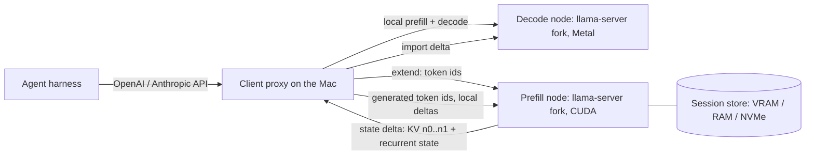

# Hybrid prefill/decode prototype: technical specification

Version 0.3, 2026-10-30. Owner: Ivan Aparin (Relux Works). Author: agents1 hybrid lane.
Status: approved for development by Ivan on 2026-10-30. Section 12 gives the work split and
section 14 the decisions, including what is still open. v0.3 adds several clients with several
sessions each (section 4a).
Builds on `prototype-plan.md` and the keeper's estimate of 2026-10-30.

## 1. Purpose and scope

The prototype proves one claim on existing engines and hardware: a GPU server can prefill an agent
session and hand the model state to a Mac, which continues decoding with the same result as if it
had prefilled locally. The hand-off over 100 Mbit/s – 1 Gbit/s must beat the Mac's own prefill on
large turns.

In scope:
- one model, Qwen3.8-27B (hybrid: 16 full-attention layers and 48 Gated DeltaNet layers);
- one GGUF file used on both sides;
- one prefill node serving several clients (Macs), each with several concurrent sessions (section 4a).

Out of scope:
- production hardening, billing and quotas;
- isolation stronger than per-client tokens and per-client session namespaces;
- other models (Flash-Next, MoE models) and other engines (MLX, Strata, vLLM);
- quality evaluation beyond the equivalence checks below.

## 2. Terms

| Term | Meaning |
|---|---|
| Session | One agent conversation: a token sequence that only grows. |
| Position n | Number of tokens in the session so far. |
| Turn delta | Tokens appended by one turn: tool output, user text. |
| State delta (n0 → n1) | Attention KV for positions [n0, n1) of the 16 attention layers, plus the full recurrent state (SSM and conv) of the 48 DeltaNet layers at position n1. |
| Snapshot | The full session state at position n, as `llama-server` slot save writes it. |
| Offload | The client sends a turn delta to the server and receives the state delta back. |
| Shadow prefill | The server prefills tokens that the client processed locally (prompt or generated) so that its copy stays identical. Not latency-critical. |
| System of record | The server's copy of every session: tokens plus state, stored in tiers. |

## 3. Model and formats

- Weights: one Qwen3.8-27B GGUF, for example Q4_K_M, with the same file and SHA-256 on server and client. The model hash goes into every state delta.
- KV cache: `q8_0` for K and V on both sides, with flash attention on. `q4_0` V is an M4 experiment.
- Recurrent state: dtype as the engine stores it (f32 today). Transfer in f32 for M0–M2; bf16 and fp8 are M4 experiments.
- Expected sizes, to be verified in M1:
  - KV: 16 layers × 2 × 4 heads × 256 dims × 1 byte ≈ 32 KiB per token;
  - state: about 157 MB in f32, 78 MB in bf16.
- llama.cpp: pin one upstream commit at the start of the project. The fork keeps patches small enough to offer upstream.

## 4. Architecture



Components:
1. **Prefill node.** A fork of `llama-server` on a CUDA host. It keeps every session as the system of
   record, prefills on request and returns state deltas. It shadow-prefills tokens the client
   produced. It stores sessions in tiers with a time-to-live.
2. **Decode node.** A fork of `llama-server` on the Mac. It imports a state delta into a slot as an
   append, decodes, and exposes the slot's token count and prefix hash.
3. **Client proxy.** A small HTTP service on the Mac, OpenAI- and Anthropic-compatible toward the
   agent harness. Per turn it chooses local prefill or offload, moves data between the nodes, and
   keeps both copies in sync. Language: Python or Go; no GPU code.

## 4a. Clients and sessions

Added in v0.3 at Ivan's request: the prototype serves several clients, each with several sessions.

- **Client.** Each client proxy has an id and a bearer token. The prefill node keeps one session
   namespace per client: a client can list, extend, snapshot or delete only its own sessions. A
   request for another client's session returns `404`, never `403`, so session ids do not leak.
- **Session.** One agent conversation, addressed on the prefill node as `(client_id, session_id)`.
- **Which session a request belongs to.** Agent harnesses send stateless chat requests that carry
   the whole message history, so the proxy recovers the session itself:
   1. **Explicit id.** If the request carries the header `X-Hybrid-Session: <id>`, the proxy uses
      it. A harness plugin or hook can set it. Pi extensions and Claude Code hooks are candidates
      for later; the prototype must not depend on them.
   2. **Prefix match.** Without a header, the proxy tokenizes the request and computes rolling
      hashes of the token ids at block boundaries (every 256 tokens). It picks the session with the
      longest matching prefix. A request that extends that session's n continues it.
   3. **Fork.** A request that matches a session only up to position p < n starts a new session.
      Its state up to p is not available: recurrent state rolls back only a few tokens (`n_rs_seq`). It
      therefore gets a full prefill, or a server-side restore from the nearest stored snapshot
      at or before p. A copy-on-write shared prefix is an M4 experiment.
   4. **New session.** Everything else is a new session.
- **Decode slots.** The decode node runs K slots (`llama-server --parallel K`).
   - The proxy maps active sessions to slots.
   - When more sessions are active than slots, it parks the least recently used session with
     slot save to local SSD, and restores it on its next request.
   - A parked session still continues by delta from the server: the proxy restores it, then
     imports the delta.
- **Prefill node scheduling.**
   - Each session has its own lock and FIFO, because extends are append-only.
   - Across sessions, latency-critical extends go first, round-robin by client so one client
     cannot starve others.
   - Shadow extends are batched across sessions when the engine allows it.
- **Proxy state.** The session table (client, session id, n, block hashes, slot, last use) is kept
   in a small local database, so it survives a proxy restart. After a restart, the proxy checks n
   and the prefix hash against the server before it reuses a session.

## 5. Prefill node interface

HTTP/2 with JSON control messages. State deltas are binary streams. Authentication is a bearer token
or mTLS between proxy and server.

| Method and path | Request | Response |
|---|---|---|
| `POST /v1/sessions` | `{model_sha256}` (client from the token) | `{session_id}` |
| `GET /v1/sessions` | — | the calling client's sessions: `[{session_id, n, tier, last_used}]` |
| `GET /v1/sessions/{id}` | — | `{n, prefix_hash, tier, last_used, model_sha256}` |
| `POST /v1/sessions/{id}/extend` | `{n0, prefix_hash_n0, tokens: [...], return_delta: true\|false}` | if `return_delta`: `200` with a state-delta stream (n0 → n0+len); else `202` (shadow, queued) |
| `GET /v1/sessions/{id}/snapshot` | — | the full state at the current n (slot-file format) |
| `DELETE /v1/sessions/{id}` | — | `204` |
| `GET /v1/health`, `GET /metrics` | — | liveness; Prometheus metrics |

Rules:
- `extend` is strictly append-only. The server checks that `n0` equals its n and that
   `prefix_hash_n0` matches. Otherwise it returns `409` with its own `{n, prefix_hash}`, and the
   client resyncs (section 7.5).
- Shadow extends of the same session are applied in order and may be batched: one prefill for
   several queued deltas.
- A latency-critical `extend` first drains the session's shadow queue, then prefills the new tokens.

## 6. State-delta format

```
header (JSON, length-prefixed):
  magic "HYBD", version 1, model_sha256, session_id, n0, n1, prefix_hash_n1,
  kv_type "q8_0", state_dtype "f32", layers: [{index, kind: attention|recurrent, bytes}]
body: one section per layer, in layer order
  attention layer: K[n0:n1] and V[n0:n1] for every KV head, in the engine's cache layout
  recurrent layer: SSM state and conv state at n1
trailer: xxh3-128 of every section, then sha256 of the whole body
```

- Sections stream as soon as each layer is ready, so the client can import while the rest arrives.
- The prefix hash is a rolling hash over token ids [0, n1). Both sides compute it the same way.
- Version 1 has no compression. M4 adds an optional zstd per section and lower-precision dtypes.

## 7. Flows

### 7.1 New session
The proxy creates the session on the server and in a client slot. The first prompt is usually large
(system prompt, files), so it normally goes through offload (7.3).

### 7.2 Turn with local prefill
1. The proxy tokenizes the delta and runs `/completion` on the decode node (the prefix is cached).
2. It queues the delta and the generated tokens as a shadow `extend` with `return_delta: false`.

### 7.3 Turn with offload
1. `extend(n0, prefix_hash, tokens, return_delta: true)`.
2. The proxy streams the delta into the decode node with `import_delta`, then checks the new
   `{n, prefix_hash}` against the trailer.
3. It runs `/completion` with an empty prompt suffix (decode only).
4. It queues the generated tokens as a shadow `extend`.

### 7.4 Server unreachable
The proxy prefills locally and keeps a local journal of unsynced token ids. On reconnect it replays
the journal as shadow extends. The agent never blocks on the server.

### 7.5 Divergence
On `409`, or when the client's prefix hash does not match after an import:
1. The proxy fetches the server snapshot and restores the slot from it.
2. Or, if the server's copy is behind, the proxy replays its journal.
3. It logs the event with both hashes. Divergence is a bug to investigate, not a normal path.

## 8. Decode node changes (llama.cpp fork)

1. Engine API, at the pinned commit. Names below are proposals. Read the upstream memory code first;
   the keeper's estimate includes a 1–2 day spike for this.
   - `llama_state_seq_get_data_range(ctx, seq, p0, p1, flags)`: export attention KV for [p0, p1)
     plus the full recurrent state at p1.
   - `llama_state_seq_set_data_append(ctx, seq, data, size)`: import it as an append. The import
     fails cleanly if p0 is not the current sequence length, the model hash differs, or a layer
     layout differs.
   - Build on the existing `llama_state_seq_*` and the `_ext` partial-state flags used for context
     checkpoints. Verify how `llama_memory_hybrid` and the recurrent cache serialize state.
2. `llama-server` endpoints:
   - `POST /slots/{id}?action=import_delta`, with the body streamed;
   - `GET /slots/{id}/info`, returning `{n, prefix_hash}`.
   - Slot save and restore stay as they are and serve M1 and resync.
3. The prefill node uses the same fork. It also needs `export_delta` (the server side of 8.1), session
   tiers (section 10) and batching of shadow extends.

## 9. Offload policy (client proxy)

Offload a turn when it is predicted to be faster than local prefill:

```
t_local   = d / P_local(L)
t_offload = T_fix + d * F(L) / P_server + (d * B_kv + S) / (C * eta)
offload if t_offload < t_local * (1 - margin)
```

Inputs:
- `P_local(L)`: local prefill rate at depth L, measured by `hybrid_bench.py` on that Mac and stored
   as a table.
- `C`: link bandwidth, an exponentially weighted moving average over recent transfers.
- `T_fix`, `P_server`: measured per server.
- `B_kv` and `S`: from section 3.
- Margin 10%, with hysteresis so that one session does not flip between paths on every turn.

The policy is a pure function with unit tests and a trace-replay mode. The replay feeds agent session
statistics (`agent_session_stats.py` output) and a link model, and prints the predicted time.

## 10. Session store (prefill node)

| Tier | Holds | Eviction |
|---|---|---|
| VRAM | Sessions in prefill now | after the request |
| Host RAM | Recently active sessions, LRU | by size |
| NVMe | Parked sessions | after a TTL (24 h by default; 72 h as an option) |

- A 110k-token session takes about 3.6 GB at 8-bit KV plus its state. M4 must show 100+ parked
   sessions on one host.
- Data at rest is encrypted, with keys held by the node.
- Logs carry no token content.

## 11. Tests and acceptance

The equivalence tests compare the decode after a state-delta import with the decode after local
prefill of the same tokens:
- same backend: greedy tokens identical for 64 tokens on at least 95% of test prompts;
- CUDA server with Metal client: identical for 64 tokens on at least 90%, mean KL at most 0.01
   nats/token over the first 64 positions. Batching and backends are not bit-deterministic, so these
   thresholds are to be calibrated in M0;
- prompts: 50 synthetic and real agent prompts at 4k, 32k and 128k depth.

Negative tests:
- each must fail with a clear error and leave the slot unchanged:
  - a delta with the wrong model hash;
  - a gap or overlap in positions (n0 ≠ n);
  - a truncated stream or a corrupt section checksum;
  - a mismatched prefix hash;
  - a layer-layout mismatch;
- a server restart in the middle of a shadow queue: no lost or duplicated tokens after recovery;
- client isolation: client A's token cannot read, extend, snapshot or delete client B's session (`404`), and B's session is unchanged afterwards;
- session mapping: two harness conversations that share a long system prompt but then diverge end up in two sessions and never import each other's deltas;
- the server unreachable: the agent continues, and the journal replays on reconnect.

Concurrency test: 3 clients × 4 sessions each, interleaved turns with offloads and local prefills.
Every session must pass the equivalence check at the end, and no session may receive another
session's delta.

Performance tests:
- bytes per token and fixed bytes per delta, against section 3;
- seconds per hand-off at 100 Mbit/s, 200 Mbit/s and 1 Gbit/s, with RTT 20–80 ms (`tc netem` on
   Linux, `dnctl`/`pfctl` on macOS);
- end-to-end replay of real agent traces: wall-clock time against local-only, within ±25% of the
   cost model in `calc/`.

## 12. Milestones and deliverables

| | Deliverable | Acceptance |
|---|---|---|
| M0 | Harness: two `llama-server` processes on one Mac, slot save → restore, equivalence script | Section 11 equivalence, same backend |
| M1 | CUDA prefill node and Mac client; whole-session transfer over HTTP | Cross-backend equivalence; measured sizes and times |
| M2 | Engine patch: range export and append import; `extend` with deltas | Equivalence after delta import; all negative tests pass |
| M3 | Client proxy with the policy, journal and resync; netem; trace replay | Real traces within ±25% of the model; agent harness works through the proxy |
| M4 | Store tiers, shadow batching, bf16/fp8 state and 4-bit V experiments, drift over N turns | 100+ parked sessions; bytes saved and drift reported |

The keeper's estimate:
- M0: 0.5–2 days;
- M1: 1–5 days after a GPU host exists;
- M2: 4 days – 3 weeks;
- M3: 3 days – 2 weeks, in parallel with M2;
- M4: 4 days – 2 weeks;
- in total: 2.5–3 weeks to M3 at best, 5–7 weeks to M4 realistically.

### Work split and review (Ivan's decision, 2026-10-30)

Two producers work in parallel, one per side:

| | Producer A: server side | Producer B: client side |
|---|---|---|
| Owns | Prefill node (section 5): `llama-server` fork for CUDA, range export, `extend`, shadow prefill, session store (section 10) | Decode node (section 8): import of a state delta as an append, slot token count and prefix hash; client proxy (section 9) with the offload policy and journal |
| Shared contract | Section 6 (state-delta format) and section 5 (HTTP API): neither side changes them alone | Same |
| First integration | A golden delta that A exports and B imports | Same |

- **Golden delta.** The golden delta is produced on the same CPU backend with a small model of the
   same layer layout (Gated DeltaNet plus full attention). The first goal for both producers is the
   M0 equivalence on Linux CPU with that small model. Qwen3.8-27B on CUDA and Metal comes after.
- **No review gate on the first build.** Each producer aims for the first working end-to-end path
   as fast as possible.
- **Cross-review.** When both halves run end to end, A reviews B's change and B reviews A's.
- **Lane review.** The lane orchestrator then reviews both and reports to Ivan whether the result is
   fit for a prototype.
- **GPU host.** It is rented once there is something ready to run on it. Until then all work and
   tests are CPU-only.

## 13. Repository layout

```
engine/      llama.cpp fork as a submodule, plus a patch series
server/      prefill node: store, extend queue, metrics
proxy/       client proxy, offload policy, journal
bench/       hybrid_bench.py, agent_session_stats.py, trace replay
tests/       equivalence, negative, performance
docs/        this spec, results
```

CI builds the engine for Linux CUDA and macOS Metal and runs the unit and negative tests. GPU and Mac
runs are manual, with the results committed under `docs/results/`.

## 14. Owner decisions

Decided by Ivan on 2026-10-30:
- Development starts now, with the work split and review order in section 12.
- The prototype serves several clients with several sessions each (section 4a).
- Producers run on Codex gpt-6.1-sol, high effort. When the plan quota is out, they continue on
   Codex API credits. Claude producers need Ivan's separate approval.
- The GPU host is rented when there is something ready to run on it. Ivan pays for it. The
   candidate is an RTX PRO 6000 or L40S at about $2.5/GPU-hour.

Still open:
- The new repository under relux-works: name and visibility.
- Resources on agents1 for a CPU build of llama.cpp and a small test model. This is the keeper's call.
- The Mac: an ivmbp worker that can build llama.cpp with Metal, and time windows for long runs.

## 15. Open questions

Read in upstream llama.cpp at `e0f142d5` (2026-10-29), without a build or a run:
- **Model support.** Qwen3.8-27B is `Qwen3_5ForConditionalGeneration`, llama.cpp arch `qwen35`. Flash-Next is
   `Qwen4ExpForConditionalGeneration`, arch `qwen4exp`. Both are on the hybrid-memory list. Gated DeltaNet kernels
   exist for CPU, CUDA (with an MMA variant) and Metal (`GGML_OP_GATED_DELTA_NET`). Correctness at the pinned
   commit still needs a run.
- **Range export is not upstream.** `llama_kv_cache::state_write` writes every cell of the sequence.
   `LLAMA_STATE_SEQ_FLAGS_PARTIAL_ONLY` skips the full-attention KV and writes only partial states (SWA and
   recurrent). The recurrent half of a state delta can therefore be exported today.
- **Append import is not upstream either.** For one sequence, `state_read_meta` starts with
   `seq_rm(dest, -1, -1)`, so an import replaces the sequence. The M2 patch is therefore narrow:
   - a position filter in the KV write;
   - an append path in the KV read: no `seq_rm`, and a check that n0 equals the current n;
   - the hybrid wrapper, which writes KV for [n0, n1) plus the full recurrent state.
- **`LLAMA_STATE_SEQ_FLAGS_ON_DEVICE`** keeps saved state in device buffers. It is a candidate for the prefill
   node's hot tier.
- **`n_rs_seq`** (experimental) keeps recurrent-state snapshots per sequence for a partial rollback. qwen35 and
   qwen4exp support it. It may let section 7.5 roll back a few tokens instead of doing a full resync; evaluate in M2–M3.

Still open:

- Does Qwen3.8-27B decode correctly on Metal and CUDA at the pinned commit (M0/M1 runs)?
- Recurrent state dtype in the engine (f32 or bf16), and whether bf16 export is lossless relative to it.
- Thresholds for cross-backend equivalence: calibrate in M0, before M1 depends on them.
